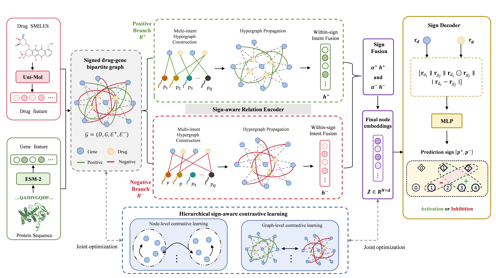

# CSIH

## Sign-Aware Intent Hypergraph Learning for Directional Drug–Gene Effect Prediction

This repository provides the PyTorch implementation of **CSIH**, a foundation-model-enhanced signed-intent hypergraph learning framework for drug–gene regulatory sign prediction.

CSIH predicts whether an observed drug–gene interaction corresponds to an **activating/up-regulating** or **inhibitory/down-regulating** regulatory effect.

<p align="center">
  
</p>

## Overview

CSIH contains five major components:

1. **Foundation Model-Based Representation Initialization** — precomputed Uni-Mol molecular representations and ESM-2 protein representations are combined with trainable identity embeddings.
2. **Sign-Aware Relation Encoding** — activation and inhibition interactions are modeled using separate message-passing channels.
3. **Signed-Intent Hypergraph Learning** — multiple sign-specific latent intent channels use learnable hyperedge prototypes and Top-K assignments to capture high-order regulatory dependencies.
4. **Late Adaptive Sign Fusion** — positive and negative high-order representations are integrated only after signed-intent hypergraph propagation.
5. **Hierarchical Contrastive Learning** — node-level and graph-level contrastive objectives, together with intent decorrelation, regularize CSIH training.

## Repository Structure

```text
CSIH/
├── README.md
├── requirements.txt
├── LICENSE
├── CITATION.cff
├── algorithm.py
├── graph.py
├── generate.py
├── parameter.py
├── util.py
├── run.py
├── run_large.py
├── baseline.py
├── ablation.py
├── cold_start.py
├── preprocess.py
├── prepare_dgidb.py
├── prepare_drugbank.py
├── prepare_lincs.py
├── extract_esm2.py
├── extract_unimol.py
├── save_results.py
├── data/
├── features/
├── splits/
├── results/
└── assets/
```

## Datasets

| Dataset | Genes | Drugs | Positive | Negative | Total |
|---|---:|---:|---:|---:|---:|
| DGIdb | 3,019 | 11,187 | 9,074 | 19,008 | 28,082 |
| DrugBank | 11,284 | 425 | 40,926 | 39,998 | 80,924 |
| LINCS L1000 | 3,769 | 187 | 9,876 | 10,734 | 20,610 |

The standardized interaction format is:

```csv
drug,gene,sign
Afatinib,EGFR,-1
Doxorubicin,TP53,1
```

`+1` denotes activation/up-regulation and `-1` denotes inhibition/down-regulation.

## Foundation-Model Features

CSIH uses precomputed **Uni-Mol** drug representations and **ESM-2 (`esm2_t33_650M_UR50D`)** protein representations.

Expected files:

```text
features/drug_features.npy
features/gene_features.npy
```

The foundation models are frozen and their representations are precomputed before CSIH training.

## Installation

Python 3.8+ is recommended.

```bash
pip install -r requirements.txt
```

## Training

Example:

```bash
python run.py \
  --data data/DGIdb.csv \
  --drug_features features/drug_features.npy \
  --gene_features features/gene_features.npy
```

The main evaluation protocol uses stratified five-fold cross-validation repeated with five independent random seeds. Only training interactions are used to construct the message-passing graph in each fold.

## Cold-Start Evaluation

The repository supports:

- drug cold-start;
- gene cold-start;
- double cold-start.

Cold-start entities are selected before graph construction. Their incident interactions are excluded from training and validation graphs, and their trainable identity embeddings are set to zero during inference.

## Evaluation Metrics

The main metrics are **AUC**, **AUPR**, and **Binary-F1**.

## Data Availability

Processed data and experimental files may be distributed only where licensing permits. Raw DrugBank data are not redistributed in this repository. Users should obtain DrugBank data through the appropriate official access route and apply the provided preprocessing script locally.

## Citation

If you use this repository, please cite:

```bibtex
@article{wang2026csih,
  title   = {Sign-Aware Intent Hypergraph Learning for Directional Drug--Gene Effect Prediction},
  author  = {Wang, Xiaosong and Chen, Guojun and Lv, Guohao and Xue, Wei and Yue, Zhenyu and Wang, Qingyong and Gu, Lichuan},
  year    = {2026},
  note    = {Manuscript}
}
```

Citation information will be updated after publication.

## Contact

**Xiaosong Wang**  
Anhui Agricultural University  
Email: xiaosongwang@stu.ahau.edu.cn
